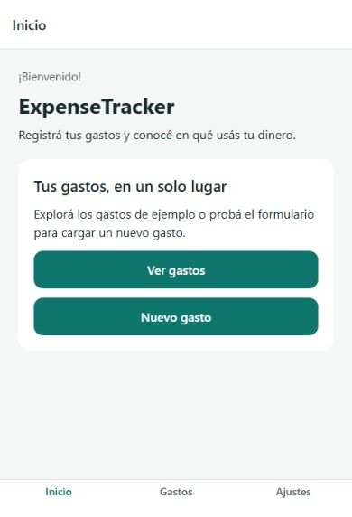
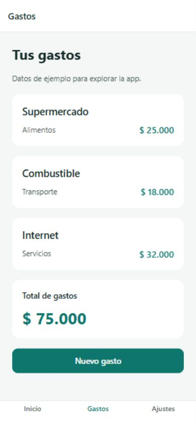
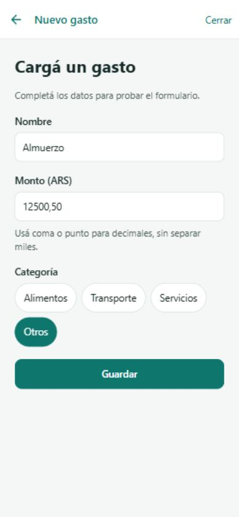

# ExpenseTracker — Sprint 1

Prototipo de React Native y Expo creado con la plantilla `blank` en la rama `STP1`.
Consigna: [ExpenseTracker Sprint 1](expense-tracker-sprint-1.md).

## Ejecutar

Requiere Node.js 22.13 o superior y npm. Desde la raíz del repositorio:

```sh
cd ExpenseTracker
npm ci
npm start
```

Abrir Expo Go actualizado y escanear el QR que muestra la terminal. El teléfono
y la computadora deben estar en la misma red Wi-Fi. Para probar en el navegador,
ejecutar `npm run web`. El simulador de iOS requiere macOS; Android puede usar
un emulador ya instalado con `npm run android`.

## Alcance implementado

| Historia | Implementación |
| --- | --- |
| US1 | Proyecto Expo `blank`, configuración, scripts y dependencias instaladas. |
| US2 | Componentes, pantallas, navegación y recursos separados en `src/`. |
| US3 | Bienvenida con ExpenseTracker y descripción del registro de gastos. |
| US4 | Formulario con nombre, monto, categoría, validación y botón Guardar. |
| US5 | Supermercado ($25.000), Combustible ($18.000) e Internet ($32.000). |
| US6 | Pestañas Inicio/Gastos/Ajustes y stack para detalle y formulario modal. |
| US7, opcional | Total de los gastos de ejemplo: $75.000. |

Guardar muestra una confirmación; no modifica la lista ni persiste datos. El monto
acepta coma o punto decimal y hasta dos decimales, sin separador de miles.
SQLite, Context y APIs remotas quedan fuera de este sprint.

## Estructura

```text
ExpenseTracker/
├── App.js
├── index.js
├── app.json
├── package.json
├── src/
│   ├── assets/
│   ├── components/
│   │   ├── ActionButton.js
│   │   └── Screen.js
│   ├── data/expenses.js
│   ├── navigation/
│   │   ├── StackNavigator.js
│   │   └── TabNavigator.js
│   ├── screens/
│   │   ├── HomeScreen.js
│   │   ├── ExpensesScreen.js
│   │   ├── ExpenseDetailScreen.js
│   │   ├── SettingsScreen.js
│   │   └── NewExpenseModal.js
│   ├── styles.js
│   └── utils/expense.js
└── tests/expense.test.mjs
```

Dependencias: Expo SDK 57, React, React Native, `expo-status-bar`,
`@react-navigation/native`, `@react-navigation/native-stack`,
`@react-navigation/bottom-tabs`, `react-native-screens` y
`react-native-safe-area-context`. `react-dom` y `react-native-web` permiten
la vista web. ESLint, TypeScript y los tipos de React se usan para verificar
el código JavaScript. `package-lock.json` fija las versiones instaladas.

## Verificación

Desde `ExpenseTracker/`:

```sh
npm test
npm run lint
npm run typecheck
npx expo install --check
npx expo-doctor
npx expo export --platform all
```

Verificado el 7 de octubre de 2026: prueba de validación de gastos y moneda ARS,
lint, chequeo de tipos, compatibilidad de dependencias, Expo Doctor (21/21)
y generación de bundles Android, iOS y web. En el navegador se comprobaron
las pestañas, el detalle y su regreso, el formulario vacío, el envío de un
monto decimal y el cierre del modal.

**Pendiente en dispositivo:** abrir el proyecto en Expo Go, comprobar la
navegación y el formulario con el teclado del teléfono y agregar capturas
nativas para la entrega. Las capturas siguientes corresponden a la vista web
en un viewport de teléfono; no acreditan ejecución en Expo Go.

## Capturas de la vista web

| Bienvenida | Gastos | Formulario |
| --- | --- | --- |
|  |  |  |

## Evidencia de participación individual

La implementación del sprint se registra en `STP1`. Para consultar la autoría
y los archivos de cada commit:

```sh
git log STP1 --format="%h %an <%ae> %s" --name-only
```

El historial acredita los cambios con la identidad Git configurada. Cada integrante
debe usar su propia identidad y registrar sus aportes; no se atribuyen aquí aportes
a personas que no figuran en el historial.

## Auditoría de dependencias

`npm audit fix` aplicó las actualizaciones compatibles disponibles. La auditoría
todavía informa 22 alertas transitivas (7 moderadas y 15 altas), asociadas a
`braces`, `node-forge` y `uuid` dentro de las herramientas de Expo/React Native.
La solución automática con `--force` propone bajar Expo a 44, por lo que no se
aplicó: rompe la base del proyecto. Revisar las correcciones oficiales antes de
una entrega de producción.

## Referencias

- [Crear un proyecto Expo](https://docs.expo.dev/get-started/create-a-project/).
- [Referencia de Expo SDK 57](https://docs.expo.dev/versions/v57.0.0/).
- [Instalación de React Navigation](https://reactnavigation.org/docs/getting-started/).
- [Tutorial de la cursada](tutorial-1-react-native-expo.md).
