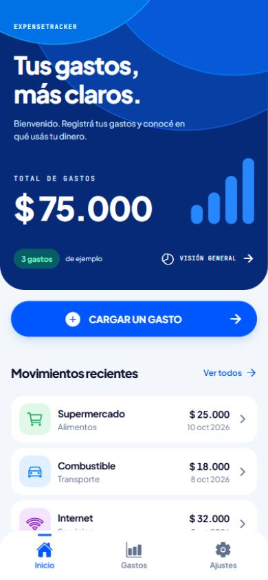
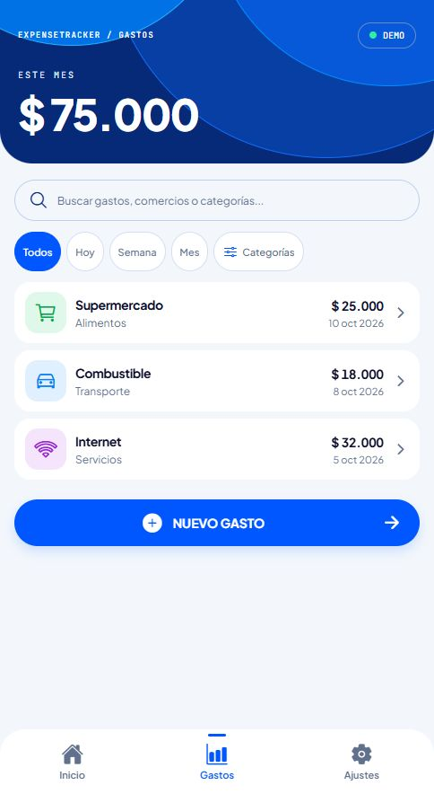
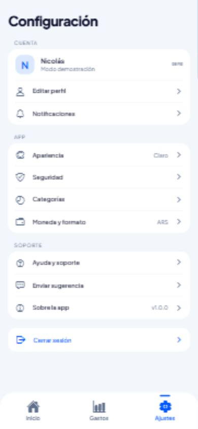
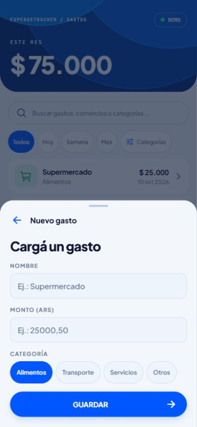

# ExpenseTracker — Sprint 1

Prototipo de React Native y Expo creado con la plantilla `blank` en la rama `STP1`.
Consigna: [ExpenseTracker Sprint 1](expense-tracker-sprint-1.md).

## Ejecutar

Requiere Node.js 22.13 o superior y npm. Desde la raíz del repositorio:

```sh
cd ExpenseTracker
npm ci
npm start
```

Abrir Expo Go actualizado y escanear el QR que muestra la terminal. El teléfono
y la computadora deben estar en la misma red Wi-Fi. Para probar en el navegador,
ejecutar `npm run web`. El simulador de iOS requiere macOS; Android puede usar
un emulador ya instalado con `npm run android`.

## Alcance implementado

| Historia | Implementación |
| --- | --- |
| US1 | Proyecto Expo `blank`, configuración, scripts y dependencias instaladas. |
| US2 | Componentes, pantallas, navegación y recursos separados en `src/`. |
| US3 | Bienvenida con ExpenseTracker y descripción del registro de gastos. |
| US4 | Formulario con nombre, monto, categoría, validación y botón Guardar. |
| US5 | Supermercado ($25.000), Combustible ($18.000) e Internet ($32.000). |
| US6 | Pestañas Inicio/Gastos/Ajustes y stack para detalle y formulario modal. |
| US7, opcional | Total de los gastos de ejemplo: $75.000. |

Guardar muestra una confirmación; no modifica la lista ni persiste datos. El monto
acepta coma o punto decimal y hasta dos decimales, sin separador de miles.
SQLite, Context y APIs remotas quedan fuera de este sprint.

Las vistas siguen las referencias móviles: hero azul con arcos, movimientos con
iconos por categoría y ajustes agrupados. Todos los botones de acción y las
selecciones usan `colors.primary` (`#0057FF`), sin gradientes. El buscador permite
buscar por nombre o categoría; los filtros usan fechas de ejemplo de octubre de
2026 y la fecha actual del dispositivo. Semana comienza el lunes. Las opciones
de configuración muestran información de la demo; no editan cuentas ni envían mensajes.

Inicio y Gastos comparten un único hero en el navegador de pestañas. Al cambiar
entre ellas se despliega o contrae durante 360 ms: título, gráfico y pie se
ocultan progresivamente y el total cambia de posición. Una transición en curso
puede invertirse. El hero permanece visible mientras se desplaza el contenido
de la pantalla. Se usa `Animated` de React Native y se respeta movimiento reducido.

Nuevo gasto y Detalle del gasto comparten un panel inferior sobre la pantalla
oscurecida: sube en 340 ms y baja en 220 ms. Se cierra con la flecha atrás,
tocando la zona superior, con Escape en web o con el botón atrás de Android.
El detalle tiene una altura menor y el formulario conserva su validación.
Los textos siguen las referencias, sin intertítulo ni explicaciones adicionales.
El contenido se desplaza si no entra y se adapta al teclado; en web el foco
permanece dentro del panel. También se respeta movimiento reducido.

## Estructura

```text
ExpenseTracker/
├── App.js
├── index.js
├── app.json
├── package.json
├── src/
│   ├── assets/
│   ├── components/
│   │   ├── ActionButton.js
│   │   ├── ExpenseHero.js
│   │   ├── ExpenseRow.js
│   │   ├── ExpenseSheet.js
│   │   └── Screen.js
│   ├── data/expenses.js
│   ├── navigation/
│   │   ├── StackNavigator.js
│   │   └── TabNavigator.js
│   ├── screens/
│   │   ├── HomeScreen.js
│   │   ├── ExpensesScreen.js
│   │   ├── ExpenseDetailScreen.js
│   │   ├── SettingsScreen.js
│   │   └── NewExpenseModal.js
│   ├── styles.js
│   └── utils/expense.js
└── tests/expense.test.mjs
```

Dependencias: Expo SDK 57, React, React Native, `expo-status-bar`,
`@react-navigation/native`, `@react-navigation/native-stack`,
`@react-navigation/bottom-tabs`, `react-native-screens` y
`react-native-safe-area-context`, `expo-font`, las fuentes Plus Jakarta Sans y
JetBrains Mono, y `@expo/vector-icons`. `react-dom` y `react-native-web` permiten
la vista web. ESLint, TypeScript y los tipos de React se usan para verificar
el código JavaScript. `package-lock.json` fija las versiones instaladas.

## Verificación

Desde `ExpenseTracker/`:

```sh
npm test
npm run lint
npm run typecheck
npx expo install --check
npx expo-doctor
npx expo export --platform all
```

Verificado el 11 de octubre de 2026: pruebas de validación, moneda ARS, búsqueda
y filtros; lint, chequeo de tipos, Expo Doctor (21/21) y generación de bundles
Android, iOS y web. En la vista web a 360 y 390 píxeles se comprobaron las
proporciones y la fila de filtros. También se verificaron las pestañas, búsqueda,
categorías, estado vacío, detalle y regreso, mensajes de configuración,
formulario vacío, envío de un monto decimal y cierre del modal.

La prueba `ExpenseTracker/tests/hero-transition.mjs`, ejecutada en el navegador
local mediante `verifyHeroTransition(tab)` en `cua_repl` con la capacidad CDP,
comprueba que el hero conserve su nodo, pase por alturas intermedias en ambos
sentidos y permita invertir la transición. También se verificaron movimiento
reducido y conservación de filtros al cambiar de pestaña.

`ExpenseTracker/tests/expense-sheet.mjs`, mediante `verifyExpenseSheets(tab)`
en el mismo navegador, comprueba las posiciones intermedias de entrada, la
validación del formulario, el detalle compacto, los cierres por flecha y zona
superior, Escape, foco con Tab y conservación de la búsqueda.

**Pendiente en dispositivo:** abrir el proyecto en Expo Go, comprobar la
navegación y el formulario con el teclado del teléfono y agregar capturas
nativas para la entrega. Las capturas siguientes corresponden a la vista web
en un viewport de teléfono; no acreditan ejecución en Expo Go.

## Capturas de la vista web

Actualizadas el 11 de octubre de 2026 siguiendo las referencias móviles,
con azul sólido, iconos de categorías y superficies de bordes redondeados.

| Inicio | Gastos | Configuración |
| --- | --- | --- |
|  |  |  |

| Nuevo gasto | Detalle compacto |
| --- | --- |
|  |  |

[Ver la transición del hero en la vista web](docs/screenshots/hero-transicion-web.gif).

## Evidencia de participación individual

La implementación del sprint se registra en `STP1`. Para consultar la autoría
y los archivos de cada commit:

```sh
git log STP1 --format="%h %an <%ae> %s" --name-only
```

El historial acredita los cambios con la identidad Git configurada. Cada integrante
debe usar su propia identidad y registrar sus aportes; no se atribuyen aquí aportes
a personas que no figuran en el historial.

## Auditoría de dependencias

`npm audit fix` aplicó las actualizaciones compatibles disponibles. La auditoría
todavía informa 22 alertas transitivas (7 moderadas y 15 altas), asociadas a
`braces`, `node-forge` y `uuid` dentro de las herramientas de Expo/React Native.
La solución automática con `--force` propone bajar Expo a 44, por lo que no se
aplicó: rompe la base del proyecto. Revisar las correcciones oficiales antes de
una entrega de producción.

## Referencias

- [Crear un proyecto Expo](https://docs.expo.dev/get-started/create-a-project/).
- [Referencia de Expo SDK 57](https://docs.expo.dev/versions/v57.0.0/).
- [Iconos en Expo](https://docs.expo.dev/guides/icons/).
- [Instalación de React Navigation](https://reactnavigation.org/docs/getting-started/).
- [Presentaciones de Native Stack](https://reactnavigation.org/docs/native-stack-navigator/).
- [Animated de React Native](https://reactnative.dev/docs/animated).
- [Adaptación al teclado](https://reactnative.dev/docs/keyboardavoidingview).
- [Tutorial de la cursada](tutorial-1-react-native-expo.md).
