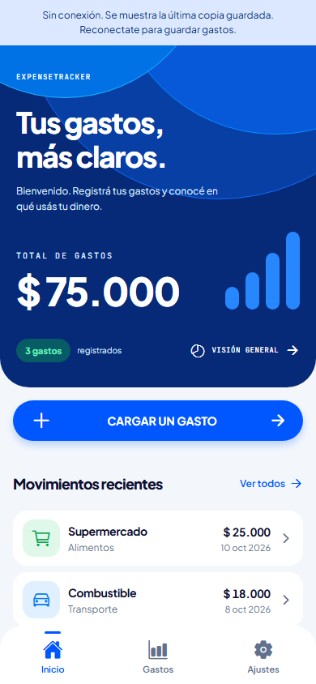
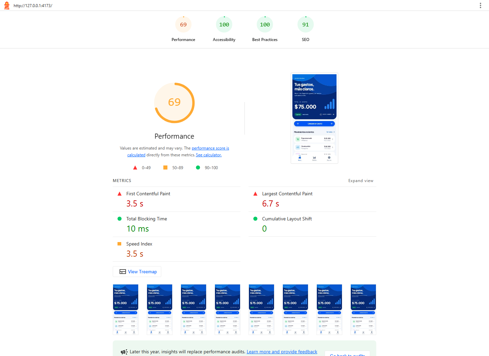
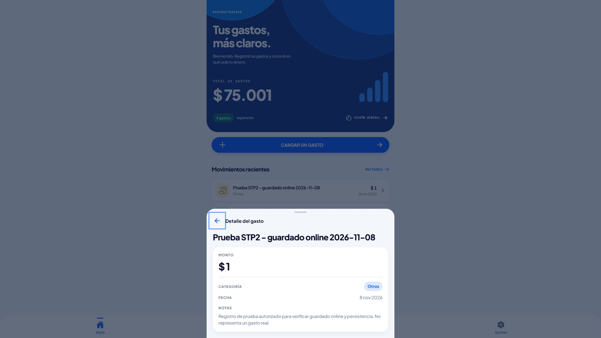

# ExpenseTracker — estado de STP2

**Fecha:** 8 de noviembre de 2026 · **Rama:** `STP2`.

La implementación web está verificada localmente y en producción con una sesión
autorizada de Access, incluida la lectura offline y un alta online real de prueba.
El commit `7abdbcf` está enviado a `origin/STP2`; la PWA está desplegada al 100% en
Cloudflare. Quedan la demostración y las capturas en teléfono, la prueba en Expo Go
y la confirmación del acceso del docente.

## Contraste con la consigna

La fuente de requisitos es el [relevamiento del 27 de octubre](requerimientos-sprint-2.md).
En esta revisión no se pudo reabrir su enlace de Notion.

| Historia | Estado comprobado | Pendiente |
| --- | --- | --- |
| US1 — React + Vite | Proyecto `pwa/`, desarrollo y build de producción | Comprobar visualización en el teléfono |
| US2 — Estructura | Separación de páginas, componentes, rutas, layout, hooks y datos | Sin faltantes de estructura observados |
| US3 — Identidad e instalación | Manifest único, íconos 192/512 y maskable, metadatos iOS, hook y banner de instalación | Instalar y comprobar identidad/standalone en teléfono |
| US4 — Inicio | Bienvenida, resumen, accesos y lista reciente | Captura equivalente en teléfono |
| US5 — Formulario | `dialog`, portal, validación, cierre, alta online real en D1 y conservación ante error | Teclado virtual y controles táctiles reales |
| US6 — Listado y detalle | Tres registros iniciales, detalle por ID, enlace directo, recarga y mensaje para ID ausente | Recorrido equivalente en teléfono |
| US7 — Navegación | Rutas reales, barra inferior, filtros, historial, foco y movimiento reducido comprobados en Chromium | Atrás del sistema en teléfono |
| US8 — PWA y offline | Build y Lighthouse local; navegación autenticada, datos offline y recarga de detalle comprobados en Chrome sobre producción con Access | Instalación y repetición de las comprobaciones en teléfono |
| US9 — Bonus | Íconos, categorías y transiciones presentes | Opcional; no condiciona el cierre obligatorio |

El uso de D1 es una ampliación autorizada del ejercicio. La consigna original
trabajaba con datos de prueba y no evaluaba persistencia ni APIs remotas.

## Comparación de las implementaciones

| Aspecto | STP1 — Expo / React Native | STP2 — React / Vite PWA |
| --- | --- | --- |
| Ejecución | Expo Go compatible con SDK 57 | Navegador y aplicación web instalada desde HTTPS |
| Componentes | `View`, `Text`, `Pressable`, estilos React Native | HTML semántico, controles web y CSS |
| Navegación | React Navigation: StackNavigator + TabNavigator | React Router, rutas por URL y MainLayout persistente |
| Formulario | Panel modal nativo de demostración | `dialog` + `showModal()` + portal; guarda por API/D1 |
| Datos iniciales | Supermercado $25.000, Combustible $18.000 e Internet $32.000 | Mismos tres registros sembrados en D1; total inicial $75.000 |
| Lectura sin conexión | Datos definidos en la app; falta comprobar Expo Go | Interfaz precacheada y última lista válida guardada con Cache API |
| Altas y persistencia | Sin persistencia en STP1 | D1 online; no hay cola ni guardado offline |
| Identidad | `app.json` y recursos Expo | Manifest, íconos web y flujo de instalación del navegador |
| Diseño | Fuentes, colores e interacciones del prototipo | Mismas fuentes y color principal `#0057FF`; adaptación web sin gradientes |
| Evidencia actual | Comprobaciones de código; prueba física pendiente | Chromium con viewport móvil y Lighthouse local; Chrome autenticado contra producción, con alta real y persistencia |

## Comportamiento offline

El Service Worker guarda los recursos de la interfaz. El servicio de gastos
conserva una lista JSON separada en Cache Storage, bajo
`expense-tracker-expenses-v1`. Un fallo de red recupera esa lista y permite abrir
por ID incluso un detalle que nunca se visitó online. Se identifica la copia
offline en la interfaz. Una lista vacía es válida; una copia inexistente produce
un mensaje que pide abrir la app con internet primero.

Se consulta primero el servidor. Un HTTP 4xx/5xx no se disimula usando la copia;
las respuestas de autenticación invalidan la copia. No se guardan respuestas
de Access ni cookies. Si el navegador bloquea Cache Storage, la consulta online
continúa funcionando. La copia puede quedar desactualizada o ser eliminada por el
navegador; para quitarla manualmente, borrar los datos del sitio. El botón de
cerrar sesión de Ajustes conserva su comportamiento demostrativo.

Las altas requieren conexión. Una respuesta de creación exitosa actualiza la
copia; si falla, los campos permanecen en el formulario y no se muestra éxito.
Al recibir el evento `online` del navegador se actualizan lista y detalle; si el
navegador no detecta la recuperación, se puede recargar manualmente.

## Comprobaciones ejecutadas

| Comando / comprobación | Resultado |
| --- | --- |
| `npx expo install expo@~57.0.32` | Expo instalado en `57.0.32`; package.json y lock actualizados |
| Raíz: `npm test` | Correcto: formulario, ARS, datos iniciales, búsqueda y filtros |
| Raíz: `npm run lint` | Exit 0 |
| Raíz: `npm run typecheck` | Exit 0 |
| Raíz: `npx expo-doctor` | 21/21 comprobaciones correctas |
| PWA: `npm test` | 5/5 tests correctos |
| PWA: `npm run build` | Correcto; genera Service Worker y precache |
| PWA: `npm run test:ui`, con `PWA_URL=http://127.0.0.1:4173` | Navegación, historial, filtros, foco, paneles, errores/confirmación y tamaños correctos |
| PWA: `npm run test:offline` contra preview | Recargas offline, detalle no visitado, ID ausente, alta fallida, alta confirmada simulada, reconexión, lista vacía, HTTP 503, redirección de autenticación y almacenamiento bloqueado |
| Revisión del diff | Agente principal; sin subagentes, sin generar `android/` ni `ios/` |

Se reprodujo primero el fallo de la recarga offline con la versión anterior.
Las comprobaciones automatizadas de navegador usan D1 local y simulan los POST;
no escriben en la D1 remota. El alta real autorizada y sus respuestas de red se
registran en la sección de verificación autenticada de este informe.
Los comandos para repetirla están en el [README de la PWA](../pwa/README.md).

La instalación de Expo informó 12 avisos de `npm audit` (11 moderados y uno alto).
Se inspeccionó el alto: Zod es una dependencia transitiva de las herramientas de
lint, no un import de la app. No se ejecutó `npm audit fix` ni una actualización
general de dependencias fuera del parche solicitado; queda como mantenimiento
separado. Los avisos no son resultados de Expo Doctor.

## Lighthouse Mobile

**Lighthouse 12.8.2**, Chrome headless, configuración Mobile predeterminada,
sobre `http://127.0.0.1:4173/`, preview de producción y D1 local.
Medición del 8/11/2026 a las 19:18 de Buenos Aires, sin advertencias de ejecución.

| Categoría | Puntaje |
| --- | ---: |
| Performance | 69 |
| Accessibility | 100 |
| Best Practices | 100 |
| SEO | 91 |

| Métrica | Valor |
| --- | ---: |
| FCP | 3,5 s |
| LCP | 6,7 s |
| TBT | 10 ms |
| CLS | 0 |
| Speed Index | 3,5 s |

[Informe HTML completo](evidence/stp2/lighthouse-mobile.report.html) ·
[Informe JSON](evidence/stp2/lighthouse-mobile.report.json)

El resultado no acredita el rendimiento de la URL pública, la red real de un
teléfono ni el paso por Access. Performance necesita mejoras: el informe señala
recursos que bloquean el renderizado, JavaScript sin usar y falta de compresión
en el servidor local. Las fuentes TTF e Ionicons añaden transferencia. SEO señala
que el fallback de la SPA devuelve HTML al solicitar `robots.txt`. La consigna
exige adjuntar Lighthouse; mejorar estos puntajes pertenece al bonus US9.

Se agregó la descripción HTML y un favicon a partir del ícono existente. La
advertencia de texto visible/nombre accesible de las tarjetas se corrigió usando
su contenido como nombre accesible, sin reemplazarlo con un `aria-label` parcial;
la comprobación de Lighthouse quedó correcta.

## Publicación verificada

El 8/11/2026 a las 19:31 de Buenos Aires se desplegó el código del
[commit 7abdbcf](https://github.com/Niquinhoo/Programacion-3/commit/7abdbcfa3e14ba41be4f007dc0aa3fc105a05043),
ya enviado a `origin/STP2`. Cloudflare confirmó la versión
`2dbc13a9-ad01-4bc0-ab24-93e478d51a32` al 100% del tráfico del Worker
`expense-tracker-pwa`. La D1, la fecha de compatibilidad y el muestreo del 10% de
logs/trazas se conservaron. Durante el despliegue no se aplicaron migraciones ni
se crearon gastos; el alta posterior autorizada se detalla a continuación.

Antes de publicar se repitieron test, lint, typecheck y Expo Doctor (21/21), los
5 tests de PWA, el build, las pruebas de UI/offline y el dry run de Wrangler.
Después se consultaron el despliegue y la configuración remotos. Las rutas `/`,
`/expenses`, `/expenses/1`, `/settings`, `/api/expenses`, `/api/expenses/1`,
`/manifest.json`, `/sw.js` y los nuevos JS/CSS respondieron 302 al dominio de Access
sin sesión. Esa comprobación verifica la protección; la navegación autenticada
se comprobó después y se registra a continuación.

Detalle y comandos: [registro de publicación](despliegue-cloudflare-sprint-2.md#publicación-del-8-de-noviembre-de-2026).

## Verificación autenticada en producción

El 8/11/2026 se comprobó la URL publicada desde Chrome de escritorio con una
sesión autorizada de Cloudflare Access. El navegador conservaba una versión
antigua: se renovó la sesión y se actualizó su Service Worker. Se confirmó el
asset publicado `assets/index-B4JG2_N9.js`; al finalizar quedó restaurada la
conexión normal y desactivada la omisión temporal del Service Worker.

| Recorrido | Resultado observado |
| --- | --- |
| Inicio y listado de D1 | Antes del alta: tres gastos iniciales y total $75.000 |
| Búsqueda y detalle | Búsqueda de Supermercado, detalle `/expenses/1`, recarga y retorno correctos |
| Navegación y formulario | Ajustes, Atrás, apertura/cancelación y validación de nombre vacío correctos |
| Producción sin conexión | Recarga de `/expenses/2`, un detalle no visitado online en esa comprobación, y retorno a Inicio con total $75.000 y aviso de copia offline |
| Alta sin conexión | Nombre y monto conservados; mensaje que pide reconectar; sin alta confirmada |
| Alta online autorizada | Una pulsación de Guardar; `POST /api/expenses` respondió HTTP 201, sin provenir del Service Worker |
| Persistencia del alta | Después de recargar Inicio y luego `/expenses/4`, los GET de listado y detalle respondieron HTTP 200 desde la red y conservaron nombre, monto, categoría, fecha y notas |

El alta se hizo el 8/11/2026 a las 19:47 de Buenos Aires. Se conserva **un único
registro de prueba** en D1; no representa un gasto real:

| Campo | Valor |
| --- | --- |
| ID | `4` |
| Nombre | `Prueba STP2 - guardado online 2026-11-08` |
| Monto | ARS 1,00 |
| Categoría | Otros |
| Fecha | 8/11/2026 |
| Notas | Registro de prueba autorizado para verificar guardado online y persistencia. No representa un gasto real. |
| Detalle | `/expenses/4` |
| Estado posterior | Cuatro gastos en producción; total $75.001 |

Los tres gastos iniciales se conservaron. Las capturas previas de Inicio y
Lighthouse muestran el estado anterior al alta, con tres gastos y total $75.000.
Esta verificación corresponde a Chrome de computadora y no acredita ejecución
en un teléfono ni en Expo Go.

## Pendientes para el teléfono y la entrega

- [x] Publicar esta revisión y comprobar la redirección a Access sin sesión.
- [x] Comprobar con sesión autorizada Inicio, lista, detalle por enlace directo y guardado, con persistencia tras recargar.
- [ ] Asegurar acceso del docente: quitar Cloudflare Access en el dashboard, publicar el hotfix del 9/11/2026 y comprobar `200` sin sesión ([pasos](despliegue-cloudflare-sprint-2.md#hotfix-del-9-de-noviembre-de-2026-acceso-público-y-responsive)). La apertura es temporal y su riesgo está [documentado](despliegue-cloudflare-sprint-2.md#riesgo-de-la-apertura-y-por-qué-se-acepta).
- [ ] Al terminar la corrección, reactivar Cloudflare Access y comprobar de nuevo la redirección sin sesión.
- [ ] En teléfono, instalar desde Chrome/Android o Safari/iOS y tomar captura
  del ícono y nombre en la pantalla de inicio.
- [ ] Abrir desde el ícono y comprobar modo standalone, áreas seguras y barra inferior.
- [ ] Con internet, esperar la primera carga y activación del Service Worker.
  Desconectar la red, cerrar y reabrir la PWA; navegar Inicio/Gastos/Ajustes,
  abrir un detalle no visitado y recargar `/expenses/1`.
- [ ] Probar el teclado virtual, cancelar y volver con el sistema. Un alta offline
  debe conservar sus campos y pedir conexión; reconectar y confirmar un alta
  controlada solo cuando corresponda crear ese registro.
- [ ] Abrir STP1 en Expo Go compatible con SDK 57 y probar navegación/formulario.
- [ ] Adjuntar capturas equivalentes de Inicio, Gastos, detalle, formulario y Ajustes
  de PWA instalada y Expo Go. Las [capturas actuales](../pwa/README.md#capturas-de-navegador)
  corresponden a Chromium de computadora.
- [ ] Si es grupal, identificar aportes de cada integrante. El historial actual
  contiene `Niquinhoo` y `Facundo Nicolás Triberti`; las identidades de Git por sí
  solas no acreditan que sean personas distintas ni trabajo colaborativo.

## Referencias

- [Documentación de Expo SDK 57](https://docs.expo.dev/versions/v57.0.0/).
- [Instalación compatible con Expo CLI](https://docs.expo.dev/more/expo-cli/#installing-dependencies).
- [Cache API — MDN](https://developer.mozilla.org/en-US/docs/Web/API/Cache).
- [Lighthouse — documentación oficial](https://developer.chrome.com/docs/lighthouse/overview).
- [Configuración y despliegue con Access](despliegue-cloudflare-sprint-2.md).
