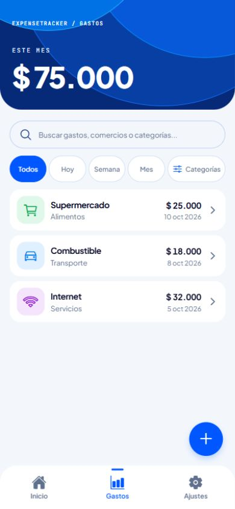
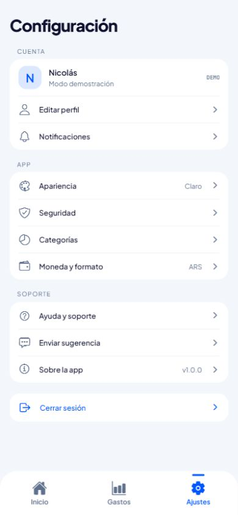

# Revisión de legibilidad y optimización

11 de octubre de 2026. Aplicadas las skills `ingenieria-verificada` y Ponytail
en nivel `full`. Se conservaron las pantallas, los datos de ejemplo, las rutas,
la validación, la accesibilidad y las duraciones de las animaciones del sprint.

## Cambios por archivo

Las rutas de esta tabla son relativas a `ExpenseTracker/`.

| Archivo | Ajuste |
| --- | --- |
| `App.js` | Elimina la carga de JetBrains Mono Bold, sin usos activos. |
| `index.js` | Elimina el comentario de plantilla que repetía la llamada de registro. |
| `src/styles.js` | Elimina la fuente y los estilos compartidos sin referencias. |
| `src/utils/expense.js` | Reutiliza el formateador de fechas y la función de normalización; evita normalizar filas sin búsqueda y parsear fechas en Todos; recorta el nombre una vez. |
| `src/hooks/useReduceMotion.js` | Reúne la consulta y suscripción repetidas; conserva la limpieza, el valor seguro ante errores y la espera inicial del panel. |
| `src/components/ActionButton.js` | Elimina la opción de icono sin consumidores y el contenedor redundante. |
| `src/components/ExpenseHero.js` | Reutiliza el hook, ordena las interpolaciones y el JSX; elimina la etiqueta DEMO y sus estilos según el ajuste solicitado. |
| `src/components/ExpenseRow.js` | Formatea una vez el monto compartido por texto y etiqueta accesible. |
| `src/components/ExpenseSheet.js` | Reutiliza el hook y un único cierre para flecha, fondo, Escape y botón Atrás; mantiene la gestión del foco. |
| `src/components/NewExpenseButton.js` | Reutiliza el hook y separa la secuencia de animación y el JSX para su lectura. |
| `src/components/Screen.js` | Ordena la firma de propiedades manteniendo sus valores predeterminados. |
| `src/navigation/TabNavigator.js` | Lee una vez la ruta activa; excluye hero y Nuevo gasto de Ajustes. |
| `src/navigation/StackNavigator.js` | Despliega las opciones del grupo modal. |
| `src/screens/HomeScreen.js` | Nombra la condición de transición y ordena las filas; conserva la reserva de scroll documentada. |
| `src/screens/ExpensesScreen.js` | Despliega el JSX; asigna igual ancho a los períodos y mantiene Categorías a la derecha sin cambiar su posición al seleccionar. |
| `src/screens/ExpenseDetailScreen.js` | Despliega categoría, fecha y detalle inexistente. |
| `src/screens/NewExpenseModal.js` | Mantiene mensaje y estado de error juntos, conserva las validaciones y ordena categorías y aviso accesible. |
| `src/screens/SettingsScreen.js` | Despliega perfil, acciones y mensajes sin cambiar su comportamiento. |
| `tests/expense.test.mjs` | Amplía la caracterización: decimales, nombres, fechas límite, filtros combinados, lista vacía y semana entre años. |
| `tests/hero-transition.mjs` | Espera que Inicio se estabilice antes de medir una transición. |
| `tests/new-expense-button.mjs` | Espera el resorte; verifica que Ajustes no muestre el botón y que siga funcionando en Gastos e Inicio. |
| `tests/expense-sheet.mjs` | Comprueba también el paso de confirmación válida a error. |
| `tests/reduced-motion.mjs` | Comprueba movimiento reducido en hero, botón y panel; restaura la emulación al finalizar. |
| `tests/expense-filters-layout.mjs` | Comprueba anchos iguales y áreas táctiles, ausencia de DEMO, alineación derecha y posición estable al cambiar períodos y categorías. |

Revisados sin cambios: `src/data/expenses.js`, `package.json`, `package-lock.json`,
`app.json`, `tsconfig.json`, `eslint.config.js`, `AGENTS.md`, `.gitignore`,
`tests/hero-scroll.mjs` y `tests/new-expense-transition.mjs`. Los datos y la
configuración ya cumplen el alcance; los dos últimos tests protegen los
recorridos existentes. No se agregaron dependencias ni infraestructura de calidad.

## Evidencia de validación

Antes del refactor pasaron `npm test`, `npm run lint`, `npm run typecheck` y
`npx expo-doctor` (21/21), además de las pruebas web de hero y panel.
Los casos nuevos de caracterización pasaron antes de modificar las utilidades.

Después del refactor pasaron:

- `npm test`: validación, ARS, fechas, búsqueda y filtros.
- `npm run lint` y `npm run typecheck`.
- `npx expo-doctor`: 21/21.
- `npx expo install --check`: dependencias compatibles.
- `npx expo export --platform all`: bundles Android, iOS y web.
- Las siete pruebas web mediante `cua_repl`, en un viewport de 390 × 844:
  `verifyHeroTransition`, `verifyHeroScroll`, `verifyNewExpenseTransition`,
  `verifyNewExpenseButton`, `verifyExpenseSheets`, `verifyReducedMotion` y
  `verifyExpenseFiltersLayout`. La última también se ejecutó a 320 y 360 px.

Medidas verificadas en web: hero de 422 px a 182 px; panel de formulario de
448 px y detalle de 332 px. Se comprobaron inversión de transición, scroll,
posición del botón flotante, validación, cierres, foco y conservación de búsqueda.
Dos pruebas medían antes de estabilizar la posición; sus esperas se ajustaron
sin quitar comprobaciones ni cambiar las animaciones de la app.

| Gastos: filtros iguales y hero sin DEMO | Ajustes: sin Nuevo gasto |
| --- | --- |
|  |  |

## Límites

La verificación web y los bundles no acreditan ejecución en Expo Go. Sigue
pendiente probar teclado y botón Atrás en un teléfono. No se actualizaron
dependencias ni se repitió la auditoría de seguridad descrita en el README.
Los archivos preexistentes de `.idea/` no se modificaron.
