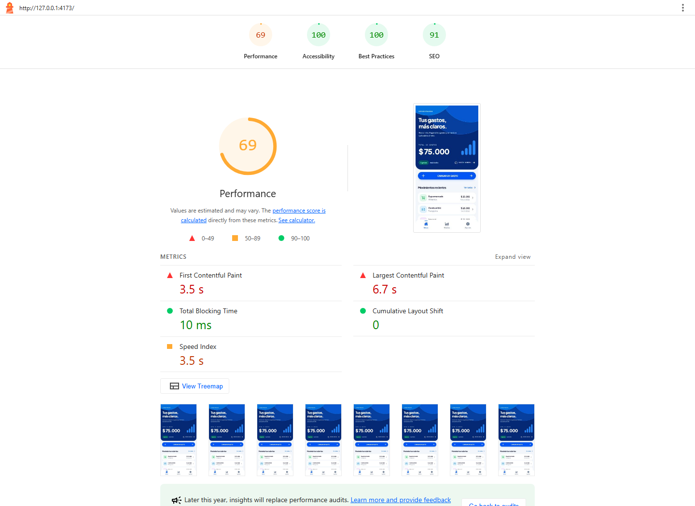
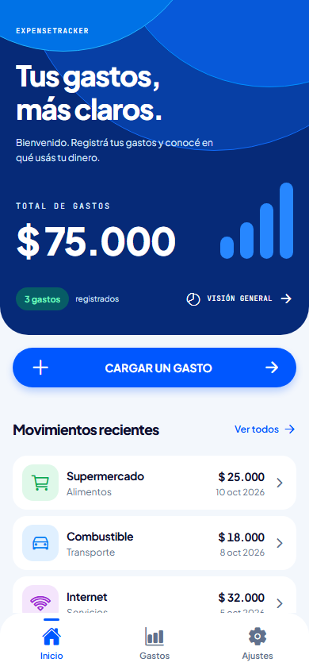
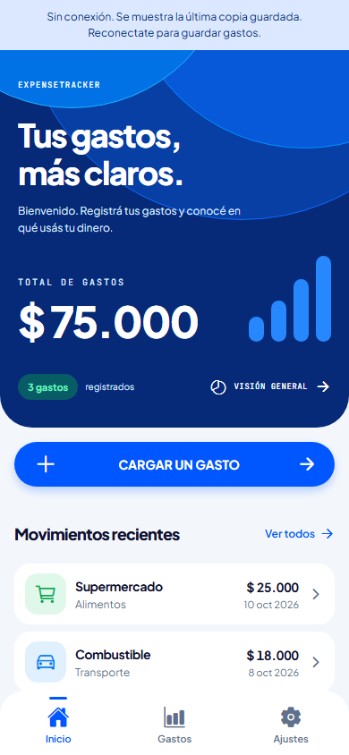

# ExpenseTracker PWA

Aplicación React + Vite servida por un Cloudflare Worker. El Worker entrega la SPA y expone una API same-origin; los gastos viven en D1 (SQLite). **No habilites una URL pública antes de configurar Cloudflare Access y verificar que la política protege el Worker completo, incluida la API.**

## Desarrollo local

Requisitos: Node.js 22.16 o posterior y npm.

`compatibility_date` usa `2026-10-26`, la fecha más reciente que admite el runtime `workerd` incluido con las dependencias locales instaladas.

```sh
npm install
npm run dev
```

El plugin Cloudflare ejecuta el Worker local y Wrangler simula D1 localmente. Para datos iniciales y altas locales, aplicá las migraciones a la base local:

```sh
npx wrangler d1 migrations apply expense-tracker-pwa --local
npm run test
npm run build
npm run preview
```

El `database_id` de `expense-tracker-pwa` ya está configurado en `wrangler.jsonc`. Para crear/aplicar el esquema inicial en una D1 nueva:

```sh
npx wrangler d1 create expense-tracker-pwa
npx wrangler d1 migrations apply expense-tracker-pwa --remote
```

La semilla usa `INSERT OR IGNORE`, así que se puede volver a aplicar sin duplicar los gastos 1/2/3. El alta de la interfaz se confirma únicamente tras una respuesta exitosa del Worker y D1. Las migraciones versionadas se guardan en `migrations/`.

## API

- `GET /api/expenses`: lista gastos.
- `GET /api/expenses/:id`: detalle por ID (404 si falta).
- `POST /api/expenses`: crea un gasto `{ "name", "amount", "category", "notes?" }`.

El servidor valida los campos y ejecuta SQL parametrizado. Las rutas de API no usan CORS. No hay credenciales en el cliente. Configurá Cloudflare Access para restringir el Worker a las personas autorizadas.

## Publicación con Cloudflare Access

El Worker está publicado en [expense-tracker-pwa.nicotrib699.workers.dev](https://expense-tracker-pwa.nicotrib699.workers.dev) y protegido por Cloudflare Access para miembros de la cuenta. `workers.dev` está habilitado y las URLs de preview permanecen desactivadas. El historial de configuración y el procedimiento de despliegue están en [el runbook](../docs/despliegue-cloudflare-sprint-2.md).

## Instalación y conexión

El manifest, el Service Worker y los assets estáticos permiten instalar y abrir la interfaz después de la primera carga. El servicio de gastos guarda la última lista obtenida correctamente de D1 en Cache Storage (`expense-tracker-expenses-v1`). Al fallar la conexión, Inicio, Gastos y los detalles por ID usan esa lista, incluso si el detalle nunca se abrió online. Se muestra un aviso de copia offline; una lista vacía también es válida. Sin una carga previa correcta se informa que no hay copia disponible.

**Las altas requieren internet.** Un alta confirmada actualiza también la copia local. Si falla, se conservan los campos del formulario y no se encola ni se confirma un gasto. Al recibir el evento `online` del navegador se actualizan listado y detalle desde D1; también se puede recargar manualmente. Un error HTTP online no se sustituye por la copia. Las respuestas de autenticación (401/403, redirección o HTML de login) invalidan la copia y piden iniciar sesión; no se cachean cookies ni páginas de Access.

La copia pertenece al perfil y origen del navegador y puede contener gastos privados. Puede quedar desactualizada o ser eliminada por el navegador. Para quitarla, borrá los datos del sitio desde la configuración del navegador; el botón «Cerrar sesión» de Ajustes sigue siendo demostrativo. Si Cache Storage está bloqueado o sin espacio, las operaciones online siguen funcionando y la lectura offline puede no estar disponible. No se agrega persistencia a la app Expo.

En Android/Chrome se ofrece «Instalar App» cuando el navegador emite `beforeinstallprompt`. En iOS/Safari, usá Compartir → Agregar a pantalla de inicio.

## Continuidad visual con STP1

La PWA usa las mismas fuentes locales (Plus Jakarta Sans y JetBrains Mono), Ionicons, colores, medidas, tarjetas, filtros y barra inferior del proyecto Expo. El encabezado responde al scroll de Inicio; al cambiar entre Inicio y Gastos, el botón de alta se transforma en botón flotante y conserva su salto final.

- Paneles de alta y detalle: apertura de **340 ms**, cierre de **220 ms**, curvas cúbicas y fondo `#101D38A6`.
- Encabezado y botón: transformación de **360 ms**, salto de **110 ms**, resorte con rigidez 220, amortiguación 14 y masa 0,5. El encabezado permanece estable **3500 ms** después de cada transición.
- Escape, fondo, flecha y atrás del navegador esperan el cierre antes de desmontar. Los filtros, el scroll y las pantallas de fondo se conservan; el detalle mantiene `/expenses/:id` y admite enlaces directos.
- El formulario inicial conserva la altura de STP1. Su ícono de nota permite desplegar las notas opcionales de STP2; el detalle muestra notas cuando existen. El guardado sigue utilizando la API/D1 y conserva el formulario ante un error.
- Se respeta la preferencia de movimiento reducido. Las fuentes e íconos se incluyen en el precache; los gastos consultados tienen una copia de lectura offline separada.

Con el servidor local activo, `npm run test:ui` ejecuta la comprobación de navegador. Requiere Playwright con Chromium disponible; se puede indicar su módulo mediante `PLAYWRIGHT_MODULE` y otro servidor mediante `PWA_URL`. No realiza altas reales: las respuestas de guardado y error se simulan dentro del navegador.

El 29/10/2026 se compararon STP1 web y STP2 con Chromium a 320, 390, 600 y 1024 px: coinciden las medidas del encabezado, botón, tarjetas, barra y formulario inicial. Se comprobaron historial, foco, filtros, apertura/cierre, scroll del encabezado, movimiento reducido, errores/confirmación de guardado y fuentes offline en producción local. La versión `2680fe12-8e4b-44e4-8830-2c55d7d2ce83` se publicó ese día en [expense-tracker-pwa.nicotrib699.workers.dev](https://expense-tracker-pwa.nicotrib699.workers.dev). Tras el despliegue, las pantallas y rutas de API probadas devolvieron `302` al inicio de sesión de Cloudflare Access. No se hicieron altas reales en D1 ni se probó desde un teléfono físico o Expo Go.

## Cierre local del 8 de noviembre de 2026

La lectura offline de datos, la actualización de Expo y la documentación de esta fecha están implementadas en la rama `STP2`, pendientes de commit y despliegue. El [informe del sprint](../docs/informe-sprint-2.md) contiene la tabla comparativa, los resultados, las fuentes y la lista de comprobaciones de teléfono pendientes.

Para repetir las comprobaciones de navegador, primero generar y servir producción:

```sh
npm run build
npm run preview
```

Con preview en `http://127.0.0.1:4173`, en otra terminal de `pwa/`:

```powershell
npm run test:offline
$env:PWA_URL = 'http://127.0.0.1:4173'
npm run test:ui
npm test
```

`test:offline` comprueba recargas de Inicio, Gastos, Ajustes y un detalle nunca visitado online, ID inexistente, formulario conservado al fallar el alta, recuperación de conexión, lista vacía, errores HTTP, invalidación por autenticación y almacenamiento bloqueado. Las consultas usan D1 local; los POST de prueba se simulan en el navegador. No crea gastos remotos. Requiere Playwright/Chromium, con la misma resolución de `PLAYWRIGHT_MODULE` que `test:ui`.

Si se vuelve a compilar mientras preview está abierto, reiniciar preview: el servidor puede conservar el índice de assets anterior y responder HTML para un archivo JS nuevo.

### Lighthouse Mobile

Se ejecutó Lighthouse **12.8.2**, en modo Mobile, sobre el preview de producción con D1 local. No se auditó la página de login de Access ni se atribuyen estos resultados a la URL desplegada.

[Informe HTML](../docs/evidence/stp2/lighthouse-mobile.report.html) · [Datos JSON](../docs/evidence/stp2/lighthouse-mobile.report.json) · [Resultados y límites](../docs/informe-sprint-2.md)



Para reproducir en Windows/PowerShell, con preview activo:

```powershell
$env:CHROME_PATH = 'C:\Program Files\Google\Chrome\Application\chrome.exe'
npx.cmd --yes lighthouse@12.8.2 http://127.0.0.1:4173 --output=html --output=json --output-path=../docs/evidence/stp2/lighthouse-mobile --chrome-flags=--headless=new --only-categories=performance,accessibility,best-practices,seo --quiet
```

### Capturas de navegador

Estas capturas tienen viewport 390 × 844 y corresponden a Chromium en computadora. La comparación y las capturas de PWA instalada/Expo Go en teléfono siguen pendientes.

| Inicio online | Inicio recargado offline |
| --- | --- |
|  |  |
